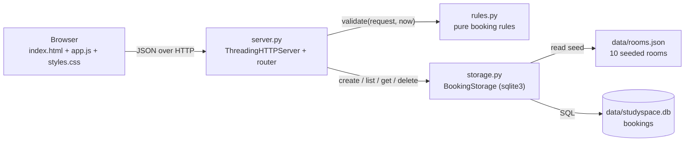
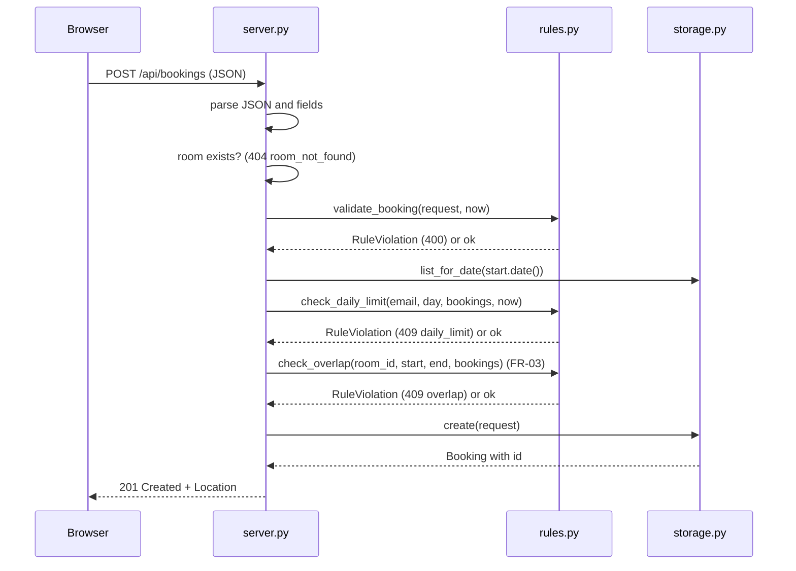
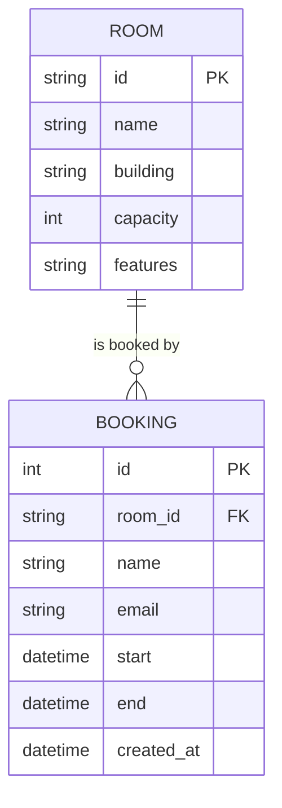

# Architecture — StudySpace

StudySpace is a single-process web application: a Python standard-library HTTP
server serves a JSON API and a single-page front-end, and persists bookings in a
local SQLite file. There is no build step, no framework and no external service.

## Component overview



The server owns all decisions. The browser only displays what the API returns, so
a stale page cannot create a conflict the server would not accept. This is the
design response to the integration issue in the project definition.

## Modules

| Module | Responsibility | Owner | Depends on |
|---|---|---|---|
| `studyspace/models.py` | Immutable dataclasses: `Room`, `BookingRequest`, `Booking`; JSON serialisation | Lei Wen | — |
| `studyspace/rules.py` | Pure rule functions and `RuleViolation` (stable error code + HTTP status) | Lei Wen | `models` |
| `studyspace/storage.py` | SQLite repository with one short-lived connection per operation; seed loader | Lei Wen | `models` |
| `studyspace/server.py` | Routing, request parsing, error mapping, static file serving, server factory | Lei Wen | `models`, `rules`, `storage` |
| `studyspace/__main__.py` | CLI: `python -m studyspace --host --port --db --rooms` | Lei Wen | `server` |
| `studyspace/web/` | Single-page front-end: search form, result cards, booking dialog, cancel | Lei Wen | API |

Rules live in one module with no I/O because they are the part of the system most
likely to change after feedback (engineering issue 1 and NFR-04). Changing a rule
means editing one pure function and one test, not the transport layer. The
`tests/` suite is owned by Lei Wen and exercises both levels.

## Create-booking sequence



## Data model



The room catalogue is seed data (`data/rooms.json`) loaded at start-up; rooms are
not editable through the API in this release. Bookings are stored with ISO-8601
local timestamps as text, which keeps the SQLite file readable and the date
filter a simple prefix query. The database file is created on first run and is
ignored by Git.

## API contract

| Method | Path | Success | Notes |
|---|---|---|---|
| GET | `/api/health` | 200 `{"status": "ok", "version": "0.1.0"}` | no database access |
| GET | `/api/rooms` | 200 `{"rooms": [...], "count": n}` | no query parameters returns the full catalogue |
| GET | `/api/rooms?start=&end=&min_capacity=` | 200 `{"rooms": [...], "count": n}` | returns only free rooms with capacity ≥ `min_capacity`; a partial or invalid window is a 400 |
| GET | `/api/bookings?date=YYYY-MM-DD` | 200 `{"date": ..., "bookings": [...], "count": n}` | ordered by start time; missing date defaults to today |
| POST | `/api/bookings` | 201 booking JSON + `Location` | validation, daily limit and overlap rules apply |
| DELETE | `/api/bookings/{id}` | 204, empty body | 404 when the booking does not exist |

Error envelope:

```json
{"error": {"code": "stable_code", "message": "human readable message"}}
```

Status codes: 400 for rule violations and invalid query parameters, 404 for an
unknown room/booking/route, 409 for a conflict (overlap or daily limit), 422 for
malformed JSON or a malformed request body.

## Static front-end

`studyspace/web/` is served from the same origin as the API. Path traversal is
rejected by resolving the requested path and confirming it stays inside
`studyspace/web/`. The front-end uses `fetch` and the `<dialog>` element; there
are no frameworks, no CDN links and no third-party assets (the assessment
environment may be offline).

## Deployment and operations

- `python -m studyspace --port 8000` runs the development/demo server.
- `data/studyspace.db` is created automatically; delete it to reset the demo.
- The server binds `127.0.0.1` by default and has no authentication, matching the
  scope exclusions.
- The test suite starts its own server on an ephemeral port with a temporary
  database, so running tests never touches the demo database.
